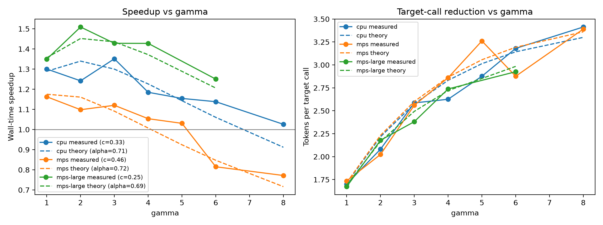

# Speculative Decoding from Scratch

From-scratch PyTorch reimplementation of **Fast Inference from Transformers via Speculative Decoding** ([Leviathan, Kalman & Matias, ICML 2023](https://arxiv.org/abs/2211.17192)): a small draft model proposes tokens, the large target model verifies them in a single parallel pass, and the output distribution stays *exactly* that of the target.

The repository contains the algorithm, a statistical test suite proving it is lossless, and experiments that compare measured speedups with the paper's closed-form predictions on GPT-2 models.

## Key results

Target: GPT-2 medium (355M) or GPT-2 large (774M), draft: GPT-2 small (124M), batch size 1, Apple M1 Pro, no KV-cache.

- **Lossless sampling.** On 3-token continuations with top-k = 5 (125 sequences, exact law computed from the target), a chi-square test on 5 x 1000 samples does not reject speculative decoding (p = 0.63, TV = 0.047). Plain autoregressive sampling gives p = 0.45, TV = 0.046, so the deviation is at the noise floor of an exact sampler.
- **Theory matches practice.** Measured speedups follow Theorem 3.8 within about 0.06x, including the slowdowns when gamma is too large.
- **Speedup depends on the cost ratio c.** With a draft only 3-6x smaller than the target (the paper uses roughly 100x), c is 0.19-0.46 and the gain is modest. The best result is 1.60x (GPT-2 large on CPU, c = 0.185, gamma = 2).

| Setup | Cost ratio c | Best gamma (measured) | Max speedup | Speedup at largest gamma (measured / theory) |
|---|---|---|---|---|
| GPT-2 medium, CPU | 0.327 | 3 | 1.35x | 1.03x / 1.00x (gamma = 8) |
| GPT-2 medium, MPS | 0.461 | 1 | 1.16x | 0.77x / 0.75x (gamma = 8) |
| GPT-2 large, CPU | 0.185 | 2 | 1.60x | 1.42x / 1.45x (gamma = 6) |
| GPT-2 large, MPS | 0.246 | 2 | 1.51x | 1.25x / 1.22x (gamma = 6) |

c is lower on CPU than on MPS for both targets, so the relative gain is larger on CPU even though MPS is faster in absolute time.

Acceptance rate alpha ranges from 0.64 to 0.84 across temperatures 0 to 1.5, higher for the larger draft and at lower temperature, as in the paper.



## Implementation

- `src/sampling.py`: logits to distributions (temperature, top-k, top-p), residual distribution `norm(max(0, p - q))`, accept/reject rule.
- `src/speculative.py`: Algorithm 1 (draft gamma tokens, one parallel target pass, first-rejection correction, bonus token).
- `src/baseline.py`: standard autoregressive decoding used as reference.
- `src/theory.py`: expected tokens per call, speedup, operation overhead, optimal gamma (Section 3).
- `src/metrics.py`: empirical alpha, call reduction, cost coefficient c.
- `src/models.py`, `src/utils.py`: GPT-2 wrapper, seeding, device handling, synchronized timers.

## Validation

50 tests, all passing:

- **Distribution tests** (`tests/test_losslessness.py`): on a toy Markov model, the exact sequence law is compared with speculative samples via chi-square for several gamma, temperatures and top-k. A control test checks that sampling from the draft alone is rejected.
- **Greedy equivalence** (`tests/test_greedy_equivalence.py`): at temperature 0, outputs are identical to the target alone, on toy models and on GPT-2 medium with a GPT-2 draft.
- **Theory** (`tests/test_theory.py`): reproduces Table 1 of the paper.
- **Primitives** (`tests/test_sampling.py`): distributions, residual, acceptance probability.

## Experiments

1. **Losslessness on GPT-2** (`exp1_losslessness`): exact law vs speculative and autoregressive frequencies.
2. **Acceptance rate** (`exp2_alpha`): alpha versus temperature and draft model, with a direct estimator E[min(p, q)] and the empirical accepted/verified ratio.
3. **Speedup versus gamma** (`exp3_speedup_vs_gamma`): measured wall-time speedup and tokens per target call against Theorem 3.8 with the measured c.

## Reproduce

```bash
pip install -r requirements.txt
pytest -v

python -m experiments.exp1_losslessness --device mps --n-samples 1000 --repeats 5
python -m experiments.exp2_alpha --device mps

python -m experiments.exp3_speedup_vs_gamma --device cpu --output-dir results/exp3_cpu
python -m experiments.exp3_speedup_vs_gamma --device mps --output-dir results/exp3_mps
python -m experiments.exp3_speedup_vs_gamma --device cpu --target gpt2-large --gammas 1 2 3 4 6 --output-dir results/exp3_cpu_large
python -m experiments.exp3_speedup_vs_gamma --device mps --target gpt2-large --gammas 1 2 3 4 6 --output-dir results/exp3_mps_large
```

Models are downloaded from Hugging Face on first use. Seeds are fixed, but wall-clock timings vary with hardware and load.

## Limitations

- No KV-cache: every forward pass recomputes the full sequence. This inflates c compared with the paper (c < 0.05) and lowers the achievable speedup.
- Single run per configuration, 8 prompts of 64 tokens: speedups carry noise of a few hundredths, and alpha varies slightly between runs.
- Batch size 1 and GPT-2 family only; no beam search and no lenience (Appendix A.5 of the paper).
- Greedy equivalence relies on identical argmax between single- and multi-position forward passes in float32.

## Context

Project for the Large Language Models course, M2 IASD, Université PSL. Supervised by Alexandre Allauzen and Paul Caillon.

Paper: Y. Leviathan, M. Kalman, Y. Matias, *Fast Inference from Transformers via Speculative Decoding*, ICML 2023.

Author: Aaron Aidoudi